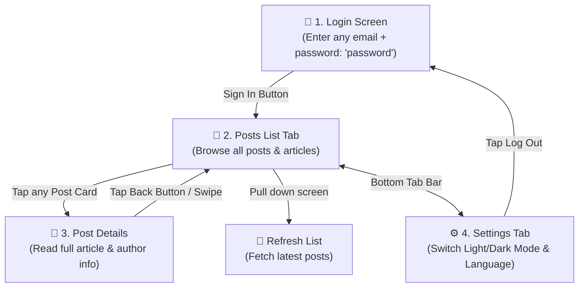

# PostExplorer 📱

An intuitive and modern mobile app built to explore, read, and browse articles and posts with ease.

---

## 🌟 What is PostExplorer?

**PostExplorer** is a simple and clean mobile application designed for reading posts. Whether you are browsing a list of articles or diving deep into a specific story, the app provides a smooth, fast, and delightful reading experience.

Even if you have **zero technical background**, this guide will walk you through exactly how the app works, screen by screen.

---

## 🗺️ App Flow at a Glance

Here is a simple map of how you move through the app:



---

## 📱 Step-by-Step App Walkthrough

### 1. 🔐 Sign-In Screen (Login)

When you open the app, you are greeted with the **Sign-In** screen.

- **Email Field**: Type any valid email address (for example: `user@example.com` or `alex@gmail.com`).
- **Password Field**: Enter the password **`password`**.
- **Help Hint**: Right below the button, a friendly note reminds you:  
  _“Login with any email and password is \"password\"”_.
- **Validation**: If you leave the fields empty or type an invalid email format, friendly helper messages guide you on what to fix.
- **Tapping "Sign In"**: Once entered correctly, you are instantly logged into the app.

---

### 2. 📰 Posts List Screen (Home)

After logging in, you arrive at the main **Posts List**.

- **Post Cards**: Each article is presented as an organized card containing:
  - **Post #Number**: The unique ID of the post.
  - **Author**: Which user wrote the post.
  - **Title**: A clear headline.
  - **Preview**: The first few lines of the post so you can quickly see what it is about.
- **Smooth Scrolling**: Scroll through posts effortlessly without any stutter or delay.
- **Pull to Refresh**: Drag down from the top of the list anytime to check for new updates. A spinning refresh icon lets you know new posts are loading.
- **Tapping a Post**: Tap anywhere on a card to open its full details.

---

### 3. 📖 Post Details Screen

When you tap a post from the list, the **Post Details** screen opens.

- **Instant Loading**: The post opens immediately without making you wait on a blank screen.
- **Full Story**: Read the complete headline and full text of the article.
- **Author & Post Tags**: Visual badges clearly highlight the Post ID and Author.
- **Going Back**: Tap the **`< Back`** button at the top left (or swipe from the edge of the screen on iPhone) to return right where you left off in the list.

---

### 4. ⚙️ Settings & Customization

PostExplorer is built to adapt to your preferences:

- **☀️ Light / 🌙 Dark Mode**: Prefer a sleek dark look at night? Switch easily between Light, Dark, or your phone's System theme.
- **🌐 Languages (English & Arabic)**: The app fully supports both English and Arabic. When Arabic is selected, the entire app smoothly flips to a right-to-left layout.
- **🚪 Log Out**: Tap **Log Out** in settings to safely exit your session and return to the login screen.

---

### 5. 🛡️ Friendly Error & Offline Handling

If something goes wrong (like losing internet connection in an elevator or subway):

- **No Mysterious Crashes**: The app never crashes or closes unexpectedly.
- **Helpful Messages**: Instead of confusing technical jargon, you get clear, plain-language notices (e.g., _"Can't reach the server. Check your connection"_).
- **Try Again Button**: Simply tap the **"Try again"** button once your connection is back.

---

## 🚀 Quick Start Guide (How to Run the App)

For team members, reviewers, or testers who want to launch the app on their computer:

### Step 1: Install Dependencies

Open your computer's terminal, go to the project folder, and run:

```bash
npm install
```

_(On Mac for iOS testing, also run: `bundle install && npm run pods`)_

### Step 2: Start the Development Server

```bash
npm start
```

### Step 3: Launch the App

- **On Android**: Run `npm run android:dev`
- **On iOS (Mac)**: Run `npm run ios:dev`

---

## 🛠️ For Developers & Technical Reviewers

<details>
<summary><strong>Click to view Technical Stack & Architecture Details</strong></summary>

### Tech Stack

- **Framework**: React Native 0.87 (Bare, New Architecture, Fabric & TurboModules, Hermes V1)
- **Language**: TypeScript 6.0 (Strict mode)
- **Compiler**: React Compiler 1.0 (`babel-plugin-react-compiler`)
- **Navigation**: `@react-navigation/native` v7 (Static API, Native Stack with auth-gated groups)
- **Data Fetching & Cache**: `@tanstack/react-query` v5 (stale-while-revalidate, optimistic rendering)
- **List Performance**: `@shopify/flash-list` v2 (Fabric recycled view cells)
- **Schema Validation**: `zod` v4
- **Localization**: `i18next` & `react-i18next` (`en`, `ar` with strict parity checking)
- **Testing**: Jest 29, Testing Library 14 (Unit tests, linking tests, auth flows)

### Verification Commands

- `npm run validate` — Full check: Typecheck + Lint + Format + i18n parity + All Unit Tests
- `npm test` — Run all test suites
- `npm run typecheck` — Strict TypeScript checking
- `npm run lint` — ESLint rules & architecture boundaries
- `npm run format:check` — Prettier code style check

</details>

---

## 📄 Summary

| What you want to do       | How to do it in the app                                 |
| :------------------------ | :------------------------------------------------------ |
| **Log in**                | Enter any email, type `password`, and tap **Sign in**   |
| **Browse posts**          | Scroll up and down on the main screen                   |
| **Read a post**           | Tap any post card to read the full content              |
| **Refresh the list**      | Drag down from the top of the posts list                |
| **Change theme/language** | Open Settings to switch appearance or language          |
| **Log out**               | Tap Log Out in Settings to return to the sign-in screen |
