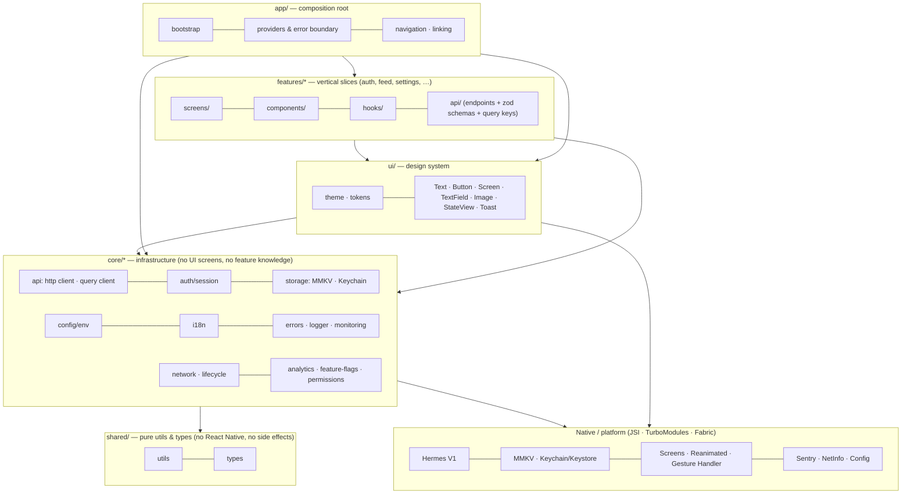

# Architecture

> Baseline is the team's React Native foundation: a bare **React Native 0.87** app (Community CLI), New Architecture + Hermes V1, TypeScript strict. This document explains how the codebase is organised, how data and control flow through it, and the rules that keep it maintainable as it grows from 10 to 100+ screens.
>
> Related: [DECISIONS.md](./DECISIONS.md) (why each technology was chosen, with evidence) · [CODING_STANDARDS.md](./CODING_STANDARDS.md) · [PERFORMANCE.md](./PERFORMANCE.md) · [DEPENDENCIES.md](./DEPENDENCIES.md) · [ENVIRONMENTS_AND_RELEASES.md](./ENVIRONMENTS_AND_RELEASES.md) · [COOKBOOK.md](./COOKBOOK.md) · [MIGRATION_FROM_REFERENCE.md](./MIGRATION_FROM_REFERENCE.md)

---

## 1. Principles

1. **Layered, feature-first.** Code is grouped by feature, and features sit on top of a small set of shared layers. Each layer may depend only on layers below it — enforced by ESLint, not by convention.
2. **One way to do each thing.** One HTTP client, one storage API, one logger, one error type, one text primitive. Raw primitives that have a better in-house replacement are banned by lint rules that name the replacement.
3. **Server state is not client state.** TanStack Query owns everything fetched from a server; Zustand holds the little that is truly client-side; components own their own UI state.
4. **Fail loudly in development, gracefully in production.** Invalid config crashes at boot; API contract drift becomes a typed, reported error, never `undefined` on screen.
5. **Secure by default.** Tokens in the Keychain/Keystore, PII redacted from every log and crash report, mocks stripped from release bundles.
6. **Measure, don't guess.** Release-mode profiling, Reassure render baselines in CI, and a performance playbook that explains _why_ each rule exists.

---

## 2. Layer diagram



**Allowed imports** (enforced by `eslint-plugin-boundaries` in [`eslint.config.mjs`](../eslint.config.mjs)):

| From ↓ / may import → | shared | core | ui  |         own feature          | other feature | app |
| --------------------- | :----: | :--: | :-: | :--------------------------: | :-----------: | :-: |
| `shared`              |   ✅   |  ❌  | ❌  |              ❌              |      ❌       | ❌  |
| `core/*`              |   ✅   |  ✅  | ❌  |              ❌              |      ❌       | ❌  |
| `ui`                  |   ✅   |  ✅  | ✅  |              ❌              |      ❌       | ❌  |
| `features/x`          |   ✅   |  ✅  | ✅  |              ✅              |      ❌       | ❌  |
| `app`                 |   ✅   |  ✅  | ✅  | `index.ts` / `mocks.ts` only |       —       | ✅  |

Additional machine-enforced rules:

- A vendor SDK may be imported only by its owning core module (`react-native-mmkv` → `core/storage`, `@sentry/react-native` → `core/monitoring`, …). Everyone else uses the module's API, so swapping a vendor touches one folder.
- Features never import each other. Cross-feature composition happens in `app/` (navigation) or through `core/` (shared session, flags).
- Outside a feature, only its public `index.ts` is importable.

Violations fail `npm run lint` (verified: feature→feature, core→ui, app→feature internals, and vendor-SDK imports are all caught).

---

## 3. Folder structure

```
.
├── index.js                     # Entry: polyfills → bootstrap() → registerComponent
├── src/
│   ├── app/                     # COMPOSITION ROOT — the only layer that knows everything
│   │   ├── App.tsx              # Provider tree (gesture/safe-area/keyboard/query/error boundary)
│   │   ├── RootErrorFallback.tsx
│   │   ├── bootstrap/
│   │   │   ├── polyfills.ts     # Intl polyfills (Hermes lacks Intl.PluralRules), zod config
│   │   │   ├── bootstrap.ts     # Ordered, synchronous startup; async session restore
│   │   │   └── mocks.ts         # Dev-only: registers each feature's mock backend
│   │   └── navigation/
│   │       ├── RootNavigator.tsx # Static config: auth-gated groups, tabs, deep-link paths
│   │       ├── Navigation.tsx   # Container: theme, linking, splash hide, screen analytics
│   │       ├── linking.ts       # Per-environment URL prefixes
│   │       └── navigationRef.ts # For navigation outside React (rare)
│   │
│   ├── features/                # VERTICAL SLICES — one folder per product capability
│   │   └── <feature>/
│   │       ├── index.ts         # Public API (usually just screens)
│   │       ├── mocks.ts         # Dev-only mock endpoints (optional)
│   │       ├── api/             # Endpoint functions, zod schemas, query-key factory
│   │       ├── hooks/           # useQuery/useMutation wrappers, feature logic
│   │       ├── components/      # Feature-private UI
│   │       └── screens/         # Route components (thin: compose hooks + components)
│   │
│   ├── ui/                      # DESIGN SYSTEM — presentational, i18n-agnostic, themed
│   │   ├── theme/               # tokens, light/dark roles, makeStyles, preference store
│   │   └── components/          # Text, Button, TextField, Screen, Image, ListRow, StateView, Toast…
│   │
│   ├── core/                    # INFRASTRUCTURE — each folder is one capability
│   │   ├── api/                 # http client, query client, persistence, mock server
│   │   ├── auth/                # Session store, token lifecycle, refresh contract
│   │   ├── config/              # Typed + validated env, build info
│   │   ├── errors/              # AppError, ErrorBoundary, error → i18n key
│   │   ├── logger/              # Levelled logger, transports, PII redaction
│   │   ├── monitoring/          # Crash/perf facade (Sentry behind it)
│   │   ├── analytics/           # Typed event catalogue + pluggable provider
│   │   ├── feature-flags/       # Typed flags, safe defaults, remote override
│   │   ├── i18n/                # i18next init, typed keys, RTL handling, locales/
│   │   ├── storage/             # MMKV (sync KV) + Keychain/Keystore (secrets)
│   │   ├── network/             # NetInfo → TanStack onlineManager, useIsOnline
│   │   ├── lifecycle/           # AppState → TanStack focusManager, useAppState
│   │   └── permissions/         # Just-in-time permission flow
│   │
│   ├── shared/                  # PURE — utils and types with zero platform deps
│   └── assets/                  # Brand + generated splash assets (fonts/images when added)
│
├── test/                        # Test helpers (renderWithProviders) and native mocks
├── .maestro/                    # E2E smoke flows (YAML, testID selectors)
├── scripts/                     # i18n parity, iOS env generation/configuration, clean
├── fastlane/                    # Release lanes (Play internal track, TestFlight)
├── .github/                     # CI, release workflow, Dependabot, PR template
├── .env.{development,qa,staging,production}   # PUBLIC build-time config per environment
├── android/                     # productFlavors dev/qa/staging/prod, R8, signing
└── ios/                         # Debug|Release × Dev|QA|Staging|Prod configs, schemes, xcconfig
```

### Why this shape scales

| Size                             | What changes                                                                             | What does not                                                                                           |
| -------------------------------- | ---------------------------------------------------------------------------------------- | ------------------------------------------------------------------------------------------------------- |
| **10 screens**                   | A few features; `core/` mostly untouched                                                 | Same rules from day one — no "we'll refactor later"                                                     |
| **50 screens**                   | More features; features grow `components/` and `hooks/` subfolders                       | `core/` and `ui/` stay small and stable; review load scales with features, not with layers              |
| **100+ screens, multiple teams** | Teams own `features/*` folders (CODEOWNERS per folder); `ui/` gets a design-system owner | Boundary rules prevent cross-team coupling; a feature can be deleted by deleting one folder + its route |

Rules of thumb for _where code goes_:

- Used by one feature → inside that feature.
- Used by two features and **presentational** → `ui/`.
- Used by two features and **infrastructural** (IO, platform, SDK) → `core/`.
- Pure function or type with no platform dependency → `shared/`.
- Needs to know about multiple features → `app/`.

There is no global `components/`, `utils/` or `services/` dumping ground.

---

## 4. Runtime flow

### 4.1 Startup

```mermaid
sequenceDiagram
    participant N as Native (splash visible)
    participant E as index.js
    participant B as bootstrap()
    participant R as React tree
    N->>E: load Hermes bytecode bundle
    E->>E: polyfills (Intl), zod jitless
    E->>B: bootstrap()
    B->>B: logger → monitoring → i18n (sync) → theme (Appearance override)
    B->>B: http auth handlers, NetInfo/AppState → TanStack
    B-->>B: restoreSession() (async: Keychain read)
    E->>R: registerComponent(Root)
    R->>R: render providers; Navigation hidden while session = "restoring"
    B-->>R: session = signedIn | signedOut
    R->>N: NavigationContainer onReady → BootSplash.hide()
```

Everything in `bootstrap()` is synchronous and cheap except session restore. Anything that is not needed for the first frame (prefetching, remote config) belongs **after** first render.

### 4.2 Data flow (server state)

```
Screen ──uses──▶ feature hook (useFeed) ──▶ useQuery({ queryKey: feedKeys.list(), queryFn })
                                                         │
                                       feedApi.getPage(cursor, signal)
                                                         │
                                http.get('/items', { schema: FeedPageSchema, signal })
                                                         │
                     ┌───────────────────────────────────┴──────────────────────────────┐
                     │ timeout (AbortSignal.any) · auth header · 401 → single-flight      │
                     │ refresh → retry · error envelope → AppError · zod safeParse        │
                     └────────────────────────────────────────────────────────────────────┘
```

- **Validated at the boundary.** Every endpoint passes a zod schema; the cache only ever holds validated data. A schema mismatch is an `AppError{kind:'parse'}` and is reported to monitoring.
- **Cancellation.** TanStack's `signal` is threaded through, so leaving a screen aborts in-flight requests.
- **Retries.** Only transient failures retry (`network`, `timeout`, `rate_limited`, 5xx), capped at 2 with backoff. Mutations never auto-retry.
- **Persistence.** Only queries with `meta: { persist: true }` are written to disk (MMKV), busted on app version + `CACHE_SCHEMA_VERSION`.

### 4.3 Authentication & session

| Concern                      | Where                        | How                                                                                                                                              |
| ---------------------------- | ---------------------------- | ------------------------------------------------------------------------------------------------------------------------------------------------ |
| Access token                 | `core/auth/tokens.ts`        | **Memory only.** Lost on cold start by design; re-obtained by refresh.                                                                           |
| Refresh token                | Keychain / Keystore          | `AFTER_FIRST_UNLOCK_THIS_DEVICE_ONLY`, never backed up or migrated.                                                                              |
| User profile (non-sensitive) | MMKV `user` store            | Restores the signed-in UI instantly. Wiped on sign-out.                                                                                          |
| Session state                | Zustand `useSessionStore`    | `restoring → signedIn                                                                                                                            | signedOut`. Holds **no tokens**. |
| Expiry                       | `httpClient`                 | 401 → one shared refresh for all concurrent requests → retry once.                                                                               |
| Refresh contract             | `core/auth/session.ts`       | Returns token · returns `null` (definitive rejection → sign out) · **throws** on transient failure, so a flaky network never signs the user out. |
| Navigation                   | `RootNavigator` `if:` groups | The navigator swaps stacks when the session flips; screens never `navigate()` after sign-in/out.                                                 |
| Sign-out                     | `endSession()`               | Flip state → clear query cache → wipe user store → reset monitoring/analytics → delete Keychain item.                                            |

### 4.4 State management rules

| Kind of state         | Tool                      | Examples                                                |
| --------------------- | ------------------------- | ------------------------------------------------------- |
| Server data           | TanStack Query            | lists, details, profiles                                |
| Global client state   | Zustand (selectors only)  | session status, theme preference, feature flags, toasts |
| Persisted preferences | MMKV via `appStorage`     | theme, language                                         |
| Form state            | react-hook-form + zod     | sign-in form                                            |
| Local UI state        | `useState` / `useReducer` | focus, toggles, wizard step                             |

Never copy server data into Zustand. Never put derived values in state — derive at render (the React Compiler memoises).

---

## 5. Cross-cutting concerns

### 5.1 Error handling

- **One error type:** `AppError { kind, status?, code?, fieldErrors?, cause }` with `isRetryable` / `isReportable`. Everything thrown is normalised with `toAppError()` at the edge.
- **User messages** come from `errorMessageKey(error)` → translated key. Raw server messages are not shown by default (untranslated, may leak internals).
- **Render errors:** a root `ErrorBoundary` (reports to monitoring, shows a hook-capable fallback with retry). Add local boundaries around risky widgets.
- **Async errors:** TanStack `QueryCache`/`MutationCache` `onError` reports `isReportable` errors; screens render `ErrorState` only when there is nothing cached to show.
- **Offline:** queries pause (`networkMode: 'online'`), a non-blocking pill appears, cached data stays visible. Navigation state is never torn down.

### 5.2 Logging, monitoring, analytics

- `logger.debug/info/warn/error` — the only logging API (`no-console` is an error). Every context object is deep-redacted (tokens, passwords, OTPs, card/ID numbers, `Bearer …`, JWTs) **before** reaching any transport.
- Transports: console in `__DEV__` only; Sentry in builds with a DSN (errors → events, info/warn → breadcrumbs).
- Monitoring facade (`reportError`, `addBreadcrumb`, `setMonitoringUser`, `withMonitoring`) keeps the vendor swappable. `sendDefaultPii: false`; users identified by opaque id only.
- Analytics is a typed catalogue (`AnalyticsEvents`) — tracking calls are compile-time checked and the tracking plan is reviewable in one file. Plug a vendor via `setAnalyticsProvider`.

### 5.3 Security (OWASP MASVS-aligned)

| Control                  | Implementation                                                                                          |
| ------------------------ | ------------------------------------------------------------------------------------------------------- |
| Secret storage           | Refresh token in Keychain/Keystore; access token in memory; nothing sensitive in MMKV                   |
| No secrets in the binary | `.env.*` holds public config only (documented in each file); secrets stay server-side                   |
| Transport                | HTTPS only (ATS on; Android cleartext only for debuggable variants via RN's manifest placeholder)       |
| Logging                  | Central redaction; console transport registered only in `__DEV__`                                       |
| Crash reports            | `sendDefaultPii: false`, `beforeSend`/`beforeBreadcrumb` scrubbing                                      |
| Backups                  | `android:allowBackup="false"`; Keychain items `THIS_DEVICE_ONLY`                                        |
| Release hardening        | R8 + resource shrinking, Hermes bytecode, release signing enforced in CI (`REQUIRE_RELEASE_SIGNING`)    |
| Deep links               | Auth-gated routes unreachable while signed out; params parsed/validated                                 |
| Dev tooling              | Mock API and dev mocks are compile-time stripped from release (verified by grepping the release bundle) |
| Opt-in per risk profile  | Certificate pinning, jailbreak/root detection, screenshot blocking — see DECISIONS.md §12               |

### 5.4 Internationalisation & RTL

- i18next + react-i18next, typed keys (`t('feed.titel')` is a compile error), resources bundled → synchronous init, no flash.
- Hermes lacks `Intl.PluralRules`; conditional `@formatjs` polyfills self-retire when Hermes ships it. Arabic's six plural forms are covered.
- **RTL strategy:** native direction via `I18nManager.forceRTL` + one restart when the _direction_ changes (same-direction language switches are instant). Styles use logical props (`marginStart`, `start/end`) and `<Text align="start">`. This mirrors native headers, gestures, back buttons and third-party components — which a JS-only RTL approach cannot. A guarded "restart once" handles first launch on an RTL device.
- `scripts/check-i18n.mjs` enforces key parity across locales (plural-aware) in pre-commit and CI.

### 5.5 Theming

- Tokens (`tokens.ts`) → a **short** list of semantic roles (`themes.ts`) → components. No screen-specific colour roles.
- The user preference is pushed into `Appearance.setColorScheme()`, so `useColorScheme()` drives the theme **and** native UI (alerts, pickers, keyboard, status bar) follows it — no React context, no extra provider.
- `makeStyles(theme => …)` builds both variants once at module load; render just selects a reference.

### 5.6 Navigation & deep linking

- React Navigation 7 **static API**: route types and linking paths are inferred from one tree; `useNavigation()` is globally typed via `declare module '@react-navigation/native'`.
- `native-stack` for all stacks (native transitions, off the JS thread); JS bottom tabs (stable) — native tabs available as `@react-navigation/bottom-tabs/unstable` when needed.
- Deep links: per-environment scheme (`baseline-dev://`) plus verified App Links / Universal Links host. iOS handles links in `SceneDelegate` (UIScene lifecycle — mandatory with the iOS 27 SDK).

### 5.7 Native integration

| Topic          | Approach                                                                                                                                             |
| -------------- | ---------------------------------------------------------------------------------------------------------------------------------------------------- |
| Architecture   | New Architecture (mandatory since RN 0.82), Hermes V1 (default since 0.84)                                                                           |
| Native modules | Prefer Nitro/TurboModule-based libraries (MMKV v4, Reanimated 4, Screens 4); legacy modules (keychain 10, device-info) run through the interop layer |
| iOS lifecycle  | `AppDelegate` (factory) + `SceneDelegate` (window, deep links)                                                                                       |
| Android        | Edge-to-edge (core flag), `RNScreensFragmentFactory`, bootsplash theme, R8                                                                           |
| Platform files | `*.ios.ts` / `*.android.ts` only when behaviour truly differs; otherwise `Platform.select` locally                                                   |

---

## 6. Quality gate — critical self-review

The questions from the brief, answered honestly after building and running the baseline on both platforms.

| Question                                 | Answer                                                                                                                                                                                                                                                                                                                                                                                                                     |
| ---------------------------------------- | -------------------------------------------------------------------------------------------------------------------------------------------------------------------------------------------------------------------------------------------------------------------------------------------------------------------------------------------------------------------------------------------------------------------------- |
| Can this scale to a large app?           | Yes: feature slices + machine-enforced layering + per-feature query keys/mocks. The bottleneck at 100+ screens is review ownership, addressed with CODEOWNERS per `features/*`.                                                                                                                                                                                                                                            |
| Anything unnecessarily complicated?      | The iOS multi-environment setup (8 configurations, generated xcconfigs) is the most complex piece. It is scripted (`npm run ios:configure`) and chosen over the simpler `/tmp/envfile` approach because the latter is shared mutable state that breaks parallel builds.                                                                                                                                                    |
| Unnecessary dependencies?                | Every runtime dependency maps to a capability in the brief (DEPENDENCIES.md). Excluded on purpose: Redux, axios, AsyncStorage, a DB, a bottom-sheet lib, an icon lib, push/notification libs (documented opt-ins). `react-native-restart` exists only for RTL direction changes.                                                                                                                                           |
| Obvious performance bottlenecks?         | None found in the reference flows (FlashList, memoised rows, stable callbacks, thumbnails vs full images, React Compiler, Hermes bytecode). Measured items and remaining risks are in PERFORMANCE.md.                                                                                                                                                                                                                      |
| Unnecessary global abstractions?         | No repository/service/DI layers; endpoint functions + hooks are the abstraction. `core/` modules are thin facades over one SDK each.                                                                                                                                                                                                                                                                                       |
| Do developers know where code belongs?   | §3 decision rules + lint errors that name the correct module.                                                                                                                                                                                                                                                                                                                                                              |
| Can features be developed independently? | Yes — no cross-feature imports, per-feature mocks, per-feature tests.                                                                                                                                                                                                                                                                                                                                                      |
| Is it secure?                            | See §5.3. Not included by default: pinning, RASP, screenshot blocking — risk-profile decisions.                                                                                                                                                                                                                                                                                                                            |
| CI/CD ready?                             | CI: typecheck, lint, format, i18n, unit/component tests with coverage, npm audit, Reassure, Android + iOS compile. Release: manual workflow → Fastlane → Play internal / TestFlight with CI-managed build numbers.                                                                                                                                                                                                         |
| Android and iOS?                         | **iOS** (simulator, iOS 27 SDK): sign-in, list, detail, deep link, dark mode (incl. native alerts), Arabic RTL restart, session restore across restarts, sign-out. **Android** (API 37 emulator): sign-in (Keystore), list with images, infinite pagination. Android `prodRelease` with R8 builds. Not yet exercised on Android: deep links, RTL, dark mode — covered by the Maestro flows, run them before first release. |
| Low-end devices?                         | Design choices favour them (virtualised lists, UI-thread animations, no context-driven re-render storms, capped page retention `maxPages`). **Not yet measured on a physical low-end device** — run the Flashlight procedure in PERFORMANCE.md before the first release.                                                                                                                                                   |
| Best practices missed?                   | Open items: physical-device profiling, Maestro in CI (flows exist; needs emulator runners), OTA updates (choice depends on hosting — DECISIONS.md §14).                                                                                                                                                                                                                                                                    |
| Anything chosen for popularity only?     | No; each choice in DECISIONS.md lists maintenance evidence and rejected alternatives. Several popular options were rejected (axios, AsyncStorage, Redux, expo-image in a bare app, `@gorhom/bottom-sheet`, Jest 30).                                                                                                                                                                                                       |

### Issues found and fixed _by actually running it_

These would have shipped had the baseline only been written, not built and run:

1. **iOS 27 SDK launch crash** — the RN 0.87 template uses the legacy window lifecycle; adopted `UIScene` (`SceneDelegate`).
2. **Release JS bundle failed** — `@formatjs/intl-locale` (static class blocks) and zod 4 (`export * as`) need Babel transforms the RN preset lacks.
3. **Mock server leaked into release bundle** — fixed with a lazy `require` behind `__DEV__`; verified by grepping the release bundle.
4. **`#if DEBUG` silently false** in custom configurations — Xcode only implies `DEBUG` for a configuration literally named "Debug".
5. **Error boundary crashed while handling an error** — fallback was called as a function (hooks outside a component).
6. **RTL text alignment wrong** — `textAlign: 'auto'` resolves to left on iOS under forced RTL; RN treats `left/right` as logical. Fixed with `align="start|end"`.
7. **Padding wiped by insets** — longhand `paddingLeft: 0` overrides the `padding` shorthand regardless of order.
8. **Locale detection trusted a regionalised tag** (`en-US`) and crashed.
9. **Persisted cache shape drift** — added `CACHE_SCHEMA_VERSION` to the cache buster.
10. **Gradle configuration-cache failures** from three third-party libraries — set to `warn` with a note to re-tighten.
