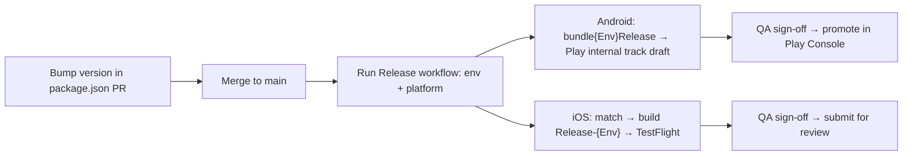

# Environments, Builds & Releases

## 1. Environments

| Environment | `.env` file        | Android flavor | iOS configurations / scheme                              | App id                     | Purpose                            |
| ----------- | ------------------ | -------------- | -------------------------------------------------------- | -------------------------- | ---------------------------------- |
| Development | `.env.development` | `dev`          | `Debug-Dev` / `Release-Dev` · `Baseline-Dev`             | `com.company.baseline.dev` | Local work; mock API on by default |
| QA          | `.env.qa`          | `qa`           | `Debug-QA` / `Release-QA` · `Baseline-QA`                | `….qa`                     | Test team builds                   |
| Staging     | `.env.staging`     | `staging`      | `Debug-Staging` / `Release-Staging` · `Baseline-Staging` | `….staging`                | Production-like pre-release        |
| Production  | `.env.production`  | `prod`         | `Debug-Prod` / `Release-Prod` · `Baseline-Prod`          | `com.company.baseline`     | Store builds                       |

Distinct app ids, display names and deep-link schemes let all four builds sit side by side on one device.

### What goes in `.env.*`

Only **public, build-time** configuration: API base URL, timeouts, deep-link scheme/host, Sentry DSN (DSNs are public by design), feature defaults. **Everything in these files is readable from the shipped binary.** Secrets (API keys with write access, signing credentials, tokens) never go here — they live in the backend or in CI secrets.

Personal overrides: copy a file to `.env.local` (git-ignored) and point a local build at it, or edit temporarily without committing.

### How values flow

```
.env.<environment>
   ├─▶ JS: react-native-config → src/core/config/env.ts (zod-validated; app refuses to start if invalid)
   ├─▶ Android: app/build.gradle reads the same file per flavor → applicationIdSuffix, app_name, deep-link placeholders
   └─▶ iOS: scripts/ios-env.mjs (runs on `pod install`) → ios/Config/Generated/<env>.xcconfig
            → bundle id suffix, display name, URL scheme, MARKETING_VERSION
            + Podfile sets ENVFILE per configuration for react-native-config
```

Adding a variable:

1. Add it to **all four** `.env.*` files.
2. Add it to `EnvSchema` in `src/core/config/env.ts`.
3. If native code needs it on iOS, add it to `NATIVE_KEYS` in `scripts/ios-env.mjs` (avoid values containing `//` — xcconfig treats that as a comment) and run `npm run pods`.
4. Update `test/mocks/react-native-config.ts`.

Adding an environment: add the `.env` file, the entry in `ENVIRONMENTS` in `android/app/build.gradle`, `scripts/ios-env.mjs`, `scripts/ios-configure-project.rb`, `ios/Podfile` and `fastlane/Fastfile`; then `npm run ios:configure && npm run pods`.

## 2. Local builds

```bash
npm run android:dev
```

```bash
npm run ios:dev
```

Release-like local builds: `npm run android:staging`, `npm run ios:staging` (Android release builds fall back to the debug key locally — see signing below).

Useful:

| Command                 | What                                                                           |
| ----------------------- | ------------------------------------------------------------------------------ |
| `npm run pods`          | `bundle exec pod install` (also regenerates iOS env xcconfigs)                 |
| `npm run ios:configure` | Re-create iOS configurations/schemes (after renaming the app or adding an env) |
| `npm run build:android` | Production AAB (`bundleProdRelease`)                                           |
| `npm run clean`         | Remove node_modules, Pods, build outputs, Metro cache                          |

## 3. Versioning

|                                                                  | Source                                                                             | Example |
| ---------------------------------------------------------------- | ---------------------------------------------------------------------------------- | ------- |
| Marketing version (`versionName` / `CFBundleShortVersionString`) | `package.json` `version` — bump in a PR (`npm version minor --no-git-tag-version`) | `1.4.0` |
| Build number (`versionCode` / `CFBundleVersion`)                 | `BUILD_NUMBER` env (CI run number); `1` locally                                    | `231`   |

Both platforms read the same values, so "1.4.0 (231)" means the same build everywhere (shown in Settings → About and sent as `X-App-Version` / `X-App-Build` headers). Semantic versioning: patch = fixes, minor = features, major = breaking changes for users (e.g., minimum OS raise).

## 4. Signing

**Android** — release builds read, in order: environment variables (`ANDROID_KEYSTORE_FILE`, `ANDROID_KEYSTORE_PASSWORD`, `ANDROID_KEY_ALIAS`, `ANDROID_KEY_PASSWORD`) or `android/keystore.properties` (git-ignored):

```properties
storeFile=/absolute/path/release.jks
storePassword=…
keyAlias=…
keyPassword=…
```

Without either, release builds use the debug key so they still install locally. CI sets `REQUIRE_RELEASE_SIGNING=true`, which turns that fallback into a build failure. Use **Play App Signing** (upload key ≠ app signing key).

**iOS** — fastlane **match** stores certificates/profiles in an encrypted git repo; CI runs `match` read-only. Each environment has its own bundle id → its own App Store Connect record (or use one record and TestFlight groups if you prefer — then align the suffixes).

## 5. CI (`.github/workflows/ci.yml`)

| Job         | Runs on           | Gates                                                                                                                                                   |
| ----------- | ----------------- | ------------------------------------------------------------------------------------------------------------------------------------------------------- |
| Quality     | every PR + `main` | `typecheck`, `lint` (incl. architecture rules), `format:check`, `i18n:check`, tests with coverage thresholds, `npm audit --omit=dev --audit-level=high` |
| Performance | PRs               | Reassure: baseline on the base branch, compare on the PR; report uploaded as artifact                                                                   |
| Android     | after Quality     | `assembleDevDebug` (x86_64 only for speed), Gradle cache                                                                                                |
| iOS         | after Quality     | `pod install` + simulator build `Debug-Dev`, Pods + ccache caches                                                                                       |

Branch protection: require Quality, Android and iOS; treat Performance as required once the baseline is stable on your runners (`reassure check-stability`).

## 6. Releases (`.github/workflows/release.yml` + `fastlane/Fastfile`)

Manual `workflow_dispatch` with `environment` (qa/staging/prod) and `platform` (android/ios/both). Uses GitHub **Environments** so production secrets require approval.



Secrets per GitHub Environment:

| Secret                                                                                              | Used by                            |
| --------------------------------------------------------------------------------------------------- | ---------------------------------- |
| `ANDROID_KEYSTORE_BASE64`, `ANDROID_KEYSTORE_PASSWORD`, `ANDROID_KEY_ALIAS`, `ANDROID_KEY_PASSWORD` | Android signing                    |
| `PLAY_STORE_JSON_KEY`                                                                               | Play upload (service account JSON) |
| `MATCH_PASSWORD`, `MATCH_GIT_BASIC_AUTHORIZATION`                                                   | iOS certificates                   |
| `APP_STORE_CONNECT_API_KEY_ID`, `APP_STORE_CONNECT_API_ISSUER_ID`, `APP_STORE_CONNECT_API_KEY`      | TestFlight upload                  |
| `SENTRY_AUTH_TOKEN` (+ `ios/sentry.properties` / env `SENTRY_ORG`, `SENTRY_PROJECT`)                | Source-map & dSYM upload           |

Sentry uploads run only when `SENTRY_AUTH_TOKEN` is present (Gradle plugin applied conditionally; Xcode phases set `SENTRY_DISABLE_AUTO_UPLOAD` otherwise), so contributors and forks build without a Sentry account.

## 7. Store requirements checklist (late 2026)

- **Google Play:** target API 36 (required for new apps/updates since 31 Aug 2026) — template targets 36, compiles against 37. 16 KB page-size support: RN ≥0.77 + AGP 9 handle it; custom NDK code needs the 16 KB linker flags. Edge-to-edge and predictive back are handled by RN ≥0.81.
- **Apple:** builds with the iOS 27 SDK require the **UIScene lifecycle** (done: `SceneDelegate`). Privacy manifest (`PrivacyInfo.xcprivacy`) present; libraries ship their own. Minimum iOS 15.1 (RN 0.87).
- Both: account deletion flow if you offer sign-up; privacy labels / Data safety form reflect Sentry & analytics usage.

## 8. Over-the-air updates

Not included (choice depends on hosting/compliance). CodePush is gone (App Center retired March 2025). Options for a bare app: **expo-updates** (EAS Update or self-hosted Expo Updates protocol; needs Expo modules), **hot-updater** (self-hosted, S3/R2), **Revopush** (CodePush-compatible SaaS). Whichever you choose: OTA may only change JS/assets, must respect store policies, and needs a rollback plan.

## 9. Upgrading React Native

1. One minor at a time. Read the release blog post + breaking changes.
2. Use the [Upgrade Helper](https://react-native-community.github.io/upgrade-helper/) diff from the current to the next version; apply native changes by hand (our Podfile, Gradle, AppDelegate/SceneDelegate are customised).
3. Check every native dependency's supported RN range (Reanimated/worklets pin tightly).
4. `npm run clean && npm install && npm run pods`, then `npm run validate`, both platform builds, Maestro flows, and a release-build smoke test (bundling issues only show up there).
